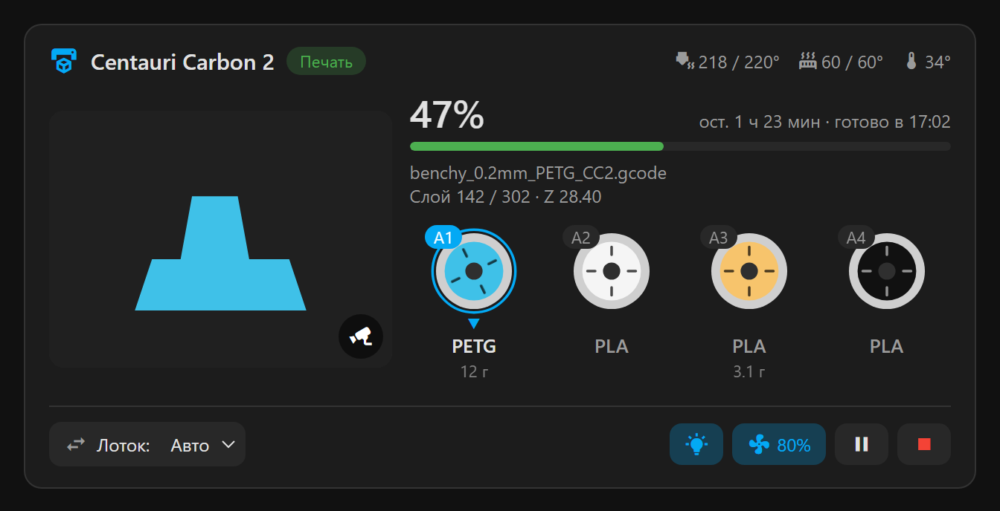
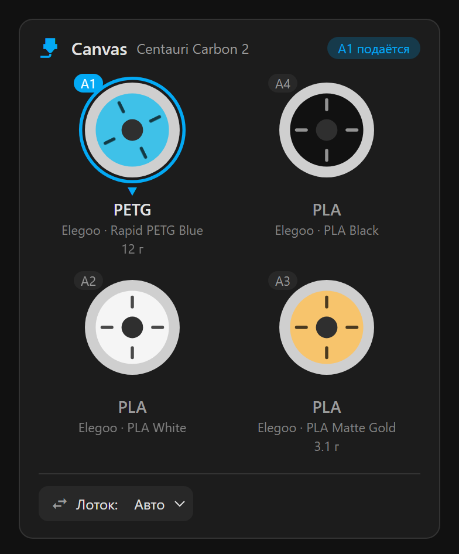
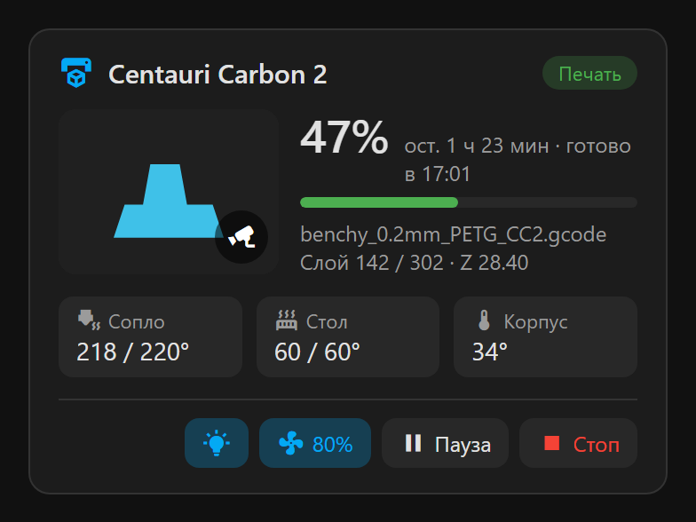
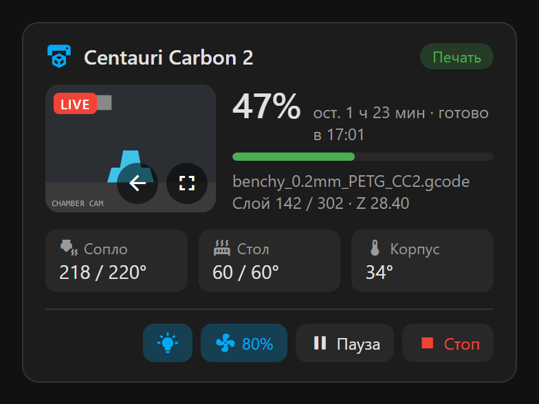

<div align="center">

# 🧵 Elegoo Canvas Card

[English](README.md) · **Русский**

**Красивые карточки Home Assistant для принтеров Elegoo с системой Canvas**

Катушки A1–A4 в том же порядке, что на принтере, живая камера, прогресс печати и управление — в одном месте.

[](https://hacs.xyz)
[](https://github.com/AlexanderDyom/elegoo-canvas-card/releases)
[](https://github.com/AlexanderDyom/elegoo-canvas-card/actions/workflows/validate.yml)
[](LICENSE)
[](https://github.com/AlexanderDyom/elegoo-canvas-card/stargazers)

[](https://my.home-assistant.io/redirect/hacs_repository/?owner=AlexanderDyom&repository=elegoo-canvas-card&category=plugin)



</div>

---

## ✨ Возможности

- 🎨 **Катушки Canvas как на принтере**: A1 над A2 слева, A4 над A3 справа, реальный цвет филамента
- 🔵 **Активный слот** подсвечен, а катушка вращается во время печати
- 🏷️ **Тип, бренд и название** филамента, расход в граммах на текущую печать
- 🔀 **Выбор лотка** (Авто / A1–A4) прямо из карточки
- 🖼️ **Превью модели**, а по нажатию **живая камера** с кнопками «назад» и «на весь экран»
- 📊 **Прогресс**, слой, высота Z, оставшееся время и время окончания
- 🌡️ **Температуры** сопла, стола и корпуса с целевыми значениями
- 💡 **Свет, вентилятор, пауза / продолжить / стоп**
- 🌗 Светлая и тёмная темы, русский и английский язык
- 🧩 **Визуальный редактор**: принтер находится автоматически, YAML не нужен

## 🖼️ Карточки

| 🧵 Canvas | 🖨️ Принтер | 📹 Камера |
|:---:|:---:|:---:|
|  |  |  |
| `custom:elegoo-canvas-card` | `custom:elegoo-printer-card` | нажатие на превью |

### 🧩 Принтер + Canvas — `custom:elegoo-combo-card`


## 📋 Что нужно

| | Что | Зачем |
|:---:|---|---|
| 🏠 | [Home Assistant](https://www.home-assistant.io) 2024.8 или новее | |
| 📦 | [HACS](https://hacs.xyz/docs/use/) | установка и обновления карточки |
| 🔌 | **[Elegoo Printers for Home Assistant](https://github.com/danielcherubini/elegoo-homeassistant)** | **обязательно**: карточка берёт все данные из этой интеграции |
| 🧾 | G-code proxy в настройках интеграции | необязательно: граммы, названия и цвета из слайсера |

> [!IMPORTANT]
> Карточка ничего не знает о принтере сама. Сначала установите и настройте интеграцию
> [elegoo-homeassistant](https://github.com/danielcherubini/elegoo-homeassistant), а уже потом эту карточку.

Проверено на **Centauri Carbon 2 Combo** с Canvas. Карточка принтера подойдёт и для других FDM-принтеров Elegoo, которые поддерживает интеграция.

## 🚀 Установка

### Через HACS (рекомендуется)

1. Нажмите кнопку **Open in HACS** выше, или вручную: HACS → ⋮ → **Пользовательские репозитории** →
   `https://github.com/AlexanderDyom/elegoo-canvas-card`, тип **Dashboard**.
2. Найдите **Elegoo Canvas Card** → **Скачать**.
3. Обновите страницу браузера (**Ctrl+F5**).

### Вручную

1. Скачайте `elegoo-canvas-card.js` со страницы [Releases](https://github.com/AlexanderDyom/elegoo-canvas-card/releases).
2. Положите файл в `/config/www/`.
3. Настройки → Панели → ⋮ → **Ресурсы** → **Добавить ресурс**: `/local/elegoo-canvas-card.js`, тип **JavaScript-модуль**.
4. Обновите страницу (**Ctrl+F5**).

## ⚙️ Настройка

Панель → ✏️ **Изменить** → **Добавить карточку** → поиск `Elegoo`. Все настройки есть в визуальном редакторе.

<details>
<summary>🧵 <b>Canvas</b> — <code>custom:elegoo-canvas-card</code></summary>

```yaml
type: custom:elegoo-canvas-card
device: 0123456789abcdef   # необязательно, если принтер один
layout: grid               # grid — 2×2 как на принтере, row — 1×4
show_details: true         # бренд, название, граммы
show_tray_select: true     # выбор лотка
```

</details>

<details>
<summary>🖨️ <b>Принтер</b> — <code>custom:elegoo-printer-card</code></summary>

```yaml
type: custom:elegoo-printer-card
camera: auto        # auto | camera | thumbnail | none
show_temps: true
show_controls: true
show_light: true
show_fan: true
```

</details>

<details>
<summary>🧩 <b>Принтер + Canvas</b> — <code>custom:elegoo-combo-card</code></summary>

```yaml
type: custom:elegoo-combo-card
layout: row
camera: auto
```

Поддерживает все параметры двух карточек выше.

</details>

### 📹 Камера

По умолчанию показывается превью модели со значком 📹. Нажатие открывает живую камеру, в ней две кнопки:
⬅️ назад к модели и ⛶ на весь экран. Если браузер или мобильное приложение не умеют полноэкранный режим,
откроется стандартное окно камеры Home Assistant.

| `camera:` | Поведение |
|---|---|
| `auto` | превью модели, камера по нажатию (по умолчанию) |
| `camera` | сразу камера |
| `thumbnail` | превью, камера по нажатию |
| `none` | без изображения |

### 🔧 Если сущность не нашлась

Карточка ищет сущности устройства по окончанию `entity_id` (`..._a1_color`, `..._print_status` и т. д.).
Если вы их переименовали, укажите нужные явно:

```yaml
type: custom:elegoo-combo-card
entities:
  a1_color: sensor.my_printer_a1_color
  active_tray: sensor.my_printer_active_tray_id
  camera: camera.my_printer_chamber_camera
```

Или `prefix: centauri_carbon_2`: поиск идёт по префиксу `entity_id`, а не по устройству.

<details>
<summary>Все ключи <code>entities</code></summary>

`print_status`, `current_status`, `progress`, `remaining`, `current_layer`, `total_layers`, `current_z`,
`filename`, `nozzle_temp`, `bed_temp`, `box_temp`, `nozzle_target`, `bed_target`, `light`, `fan`,
`pause`, `resume`, `stop`, `print_tray`, `active_tray`, `canvas_connected`, `camera`, `thumbnail`,
`aN_color`, `aN_name`, `aN_type`, `aN_grams` (N = 1…4).

</details>

## ❓ Частые вопросы

**Что значат граммы под катушкой?** Это сколько филамента уйдёт из слота на *текущую* печать (из G-code), а не остаток на катушке.
Без G-code proxy в интеграции граммов не будет.

**Карточки нет в списке.** Обновите страницу через Ctrl+F5. В консоли браузера (F12) должна быть строка `ELEGOO-CANVAS-CARD`.

**Карточка показывает прочерки.** Проверьте, что интеграция Elegoo работает и принтер в сети, или укажите сущности вручную (см. выше).

## 🧪 Демо без Home Assistant

```bash
python -m http.server 8765
```

После запуска откройте http://localhost:8765/demo/: карточки на тестовых данных, статус можно переключать кнопками.

## 🙏 Благодарности

- [danielcherubini/elegoo-homeassistant](https://github.com/danielcherubini/elegoo-homeassistant) — интеграция, без которой этой карточки бы не было
- [Elegoo](https://www.elegoo.com) — за Centauri Carbon 2 и Canvas

Проект не связан с Elegoo и не поддерживается ею.

## 📄 Лицензия

[MIT](LICENSE)
